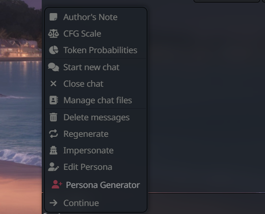
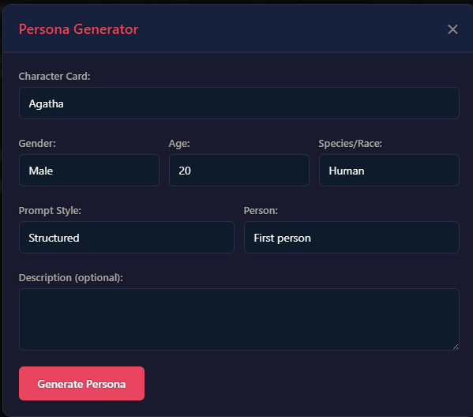
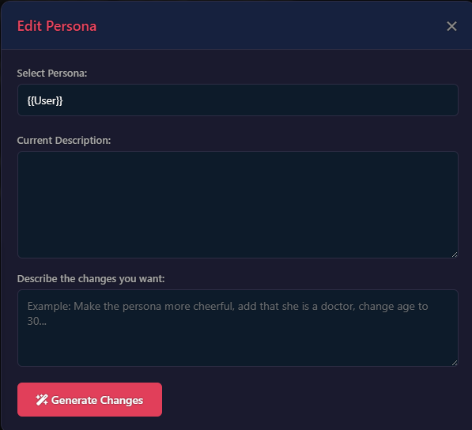

# SillyTavern Persona Generator Extension

Generate and edit personas from character cards using AI, directly inside SillyTavern.

## Features

- **Generate Personas** - Create personas from character cards with AI
- **Edit Personas** - Modify existing personas with natural language requests
- **Multiple AI Providers** - Uses SillyTavern's configured API (OpenAI, Anthropic, Groq, etc.)
- **Auto-detect Character** - Automatically detects the current character
- **Multiple Characters** - Select from any loaded character
- **4 Prompt Styles** - Narrative, Structured, Profile, Dialogue
- **Person Options** - First person or third person perspective
- **Dark Theme** - Matches SillyTavern's dark theme
- **Direct Integration** - Saves personas directly to SillyTavern

## Screenshots

### Menu Access


### Persona Generator


### Edit Persona


## Installation

### Method 1: Via Git (Recommended)

1. Open SillyTavern
2. Go to Extensions > Install Extensions
3. Enter the repository URL:
   ```
   https://github.com/rafaelramalheteagls-cmd/sillytavern-extension-persona-generator.git
   ```
4. Click Install

### Method 2: Manual Installation

1. Clone this repository:
   ```bash
   git clone https://github.com/rafaelramalheteagls-cmd/sillytavern-extension-persona-generator.git
   ```
2. Copy the folder to `SillyTavern/public/scripts/extensions/third-party/`
3. Restart SillyTavern

## Usage

### Via Slash Command

- Type `/persona-gen` in the chat input to open the Persona Generator.

### Via Menu

1. Click the hamburger menu (top right)
2. Click **Edit Persona** to modify existing personas
3. Click **Persona Generator** to create new personas

### Via Extension Settings

1. Go to Extensions > Persona Generator
2. Click "Open Persona Generator"

## How It Works

### Generating a Persona

1. **Select Character** - Choose which character to generate a persona for
2. **Configure Options** - Choose style and perspective, set an optional relationship and opening hook, and select which character card fields the model receives
3. **Generate** - Click "Generate Persona" to create the persona
4. **Refine** - Edit the draft directly. With **Structured**, choose an available section and click **Regenerate Section** to replace only that section.
5. **Save** - Click **Create in SillyTavern** to save the persona.

Open **Group chat** to add other character cards and specify relationships using their names. The same card-field settings apply to each selected character.

Use **Preview Prompt** to inspect the text sent by the extension before generating. You can request up to three proposals from the same prompt, compare the completed results, and choose which to edit and save. Each proposal makes a separate request to your provider. Select an optional PNG, JPEG, WebP, or GIF avatar before saving.

Set an optional output token limit before generating. The model receives this limit and the draft displays an estimated count for the whole description. Section regeneration is a separate request, so check the total again afterward.

### Editing a Persona

1. **Select Persona** - Choose the persona you want to modify
2. **Describe Changes** - Tell the AI what changes you want (e.g., "Make her a doctor", "Change age to 30")
3. **Generate** - Click "Generate Changes" to get the modified description
4. **Save** - Use **Save Changes** to update the original description, or enter a name and choose **Save as New Persona** to create a separate persona with the edited description. Choose whether the copy uses the original image, a custom image, or the generator’s placeholder avatar.

Use **Search personas**, **Favorites only**, or **Character of origin** to find an existing persona. Origin is recorded for new personas and adaptations created by the extension. Add comma-separated tags or archive a persona to hide it from the extension’s active view. Use the library view selector to find archived personas.

Choose **Adapt to a different character** to reuse an existing identity in another setting. Save the adaptation as a new persona. Use **Protected facts** to list phrases that must appear in the edited description. The editor checks phrase presence, ignoring case and whitespace differences.

Open **Compare changes** to see added and removed lines. The editor keeps the last ten descriptions saved through the extension. Open **Previous versions**, preview a version, and select **Restore This Version** to restore it.

Open **Roleplay reference card** to generate or edit short notes on voice, goals, and sample replies. The card is stored separately from the persona description.

Use **Library backup** to export personas, avatars, description settings, and extension metadata such as history, tags, protected facts, and roleplay cards. Select the JSON file to preview an import. For matching names, choose whether to skip the entry or create it under a new name. Connected chats and lorebook contents stay in SillyTavern.

The latest generator draft and the latest edit draft are retained in your SillyTavern settings. Reopen the relevant dialog to continue, or select **Discard Draft** to clear it.

## Prompt Styles

| Style | Description |
|-------|-------------|
| **Narrative** | Natural, flowing first/third person narrative |
| **Structured** | XML-tagged sections with detailed breakdown |
| **Profile** | Character sheet format with fields |
| **Dialogue** | Spoken dialogue format |

## Settings

| Setting | Default | Description |
|---------|---------|-------------|
| Default Prompt Style | Structured | Default style for new generations |
| Default Person | First person | Default narrative perspective |
| Default Gender | Male | Default gender for personas |
| Default Age | 25 | Default age for personas |
| Default Species | Human | Default species/race |

## Compatibility

- SillyTavern 1.19.0 or newer required. Compatibility target: 1.19.0.
- Works with: Chat Completion API, Text Completion API

## License

MIT License
